# IrrigationGenie

A weather-smart sprinkler controller for the home. An ESP32 with a 2.8" touch screen drives
7 zones and a master valve, and serves a phone app over WiFi. Besides manual and day-of-week
scheduling, it has a **Smart** mode that scales every run using the local weather forecast.
It waters less after rain or ahead of it, skips in freezing or windy weather, and waters more
in hot, dry spells.

<p align="center">
  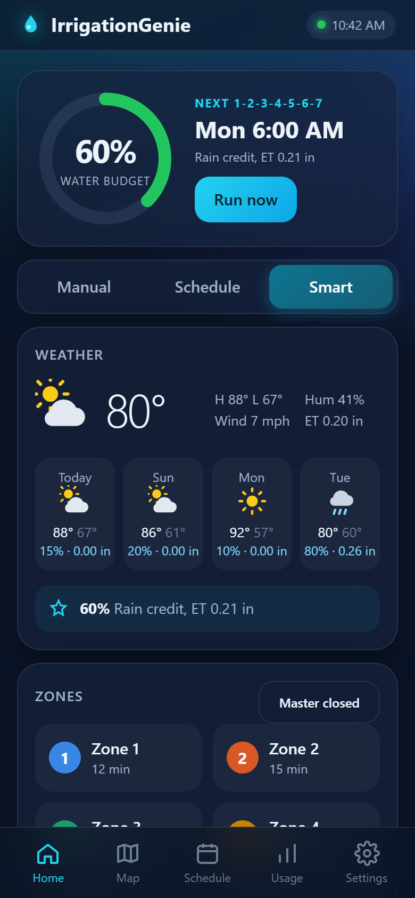
  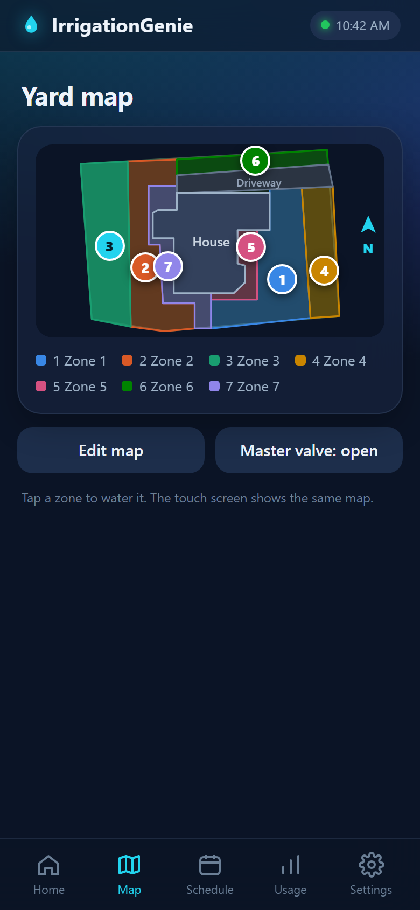
  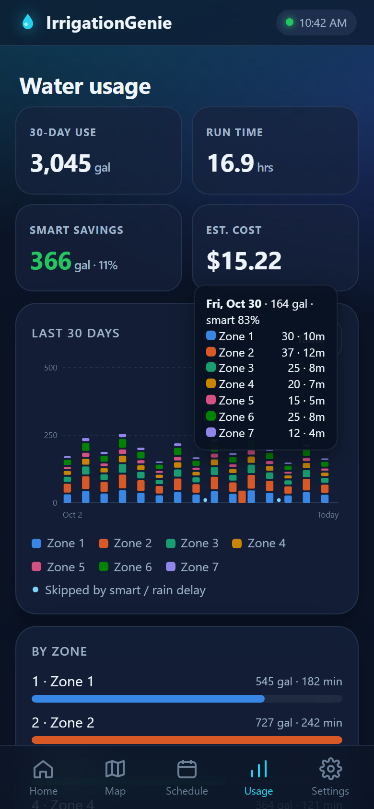
</p>

## Features

- **Three watering modes:** Manual (tap any of the 7 zones on the home screen and pick a run time,
  whether or not the zone is in the schedule), Schedule (2 start times, days of week, minutes per zone) and Smart
- **Smart watering** from free [Open-Meteo](https://open-meteo.com) forecasts, no API key needed (see below)
- **7 zones + master valve:** the master opens only while a zone runs; safety cutoff, one zone at a time by default
- **Winter mode:** closes the master and opens every zone to drain the lines
- **Yard map** on the screen and the phone, so you're not guessing what zone 4 is. Zones light up while running.
  Start from a drawn yard plan, a satellite view of your address, or a photo.
- **30-day water usage** per zone (from valve on-time and each zone's flow rate), smart savings, estimated cost
- **Touch screen UI:** home, smart details, map, schedule editor, usage chart, info, settings,
  WiFi setup with on-screen keyboard, touch calibration, bouncing-clock screen saver
- **Phone app:** a modern single-page web app served by the ESP32 at `http://irrigationgenie.local`
- **Location from the phone** (GPS or city/ZIP search). The time zone and daylight-saving rules come from
  the phone, and the clock syncs from the internet at startup and every midnight.
- **Sounds** on a piezo: startup, key click, zone on/off, internet-lost warning
- Rain delay (24/48/72 h), °F/°C, 12/24 h clock, adjustable brightness

## Touch screen

All screens below are rendered from the actual firmware drawing code (see [Screenshots](#regenerating-the-screenshots)).

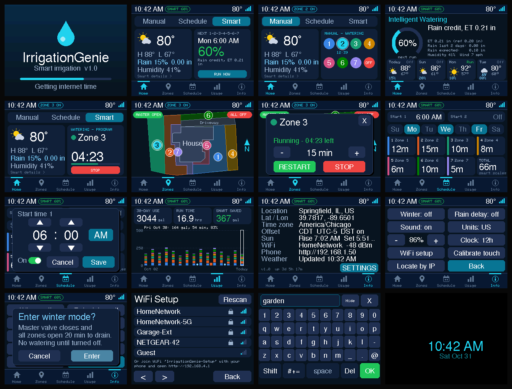

| | | |
|---|---|---|
| 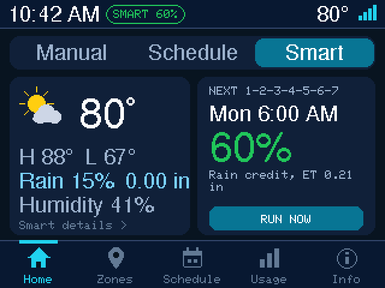 | 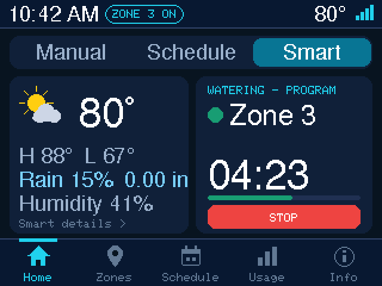 | 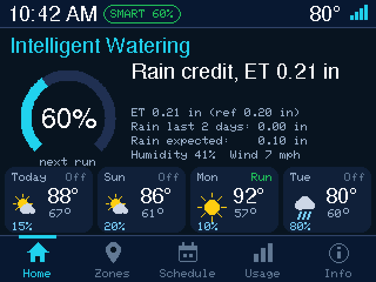 |
| Home (Smart mode) | Watering | Smart watering details |
| 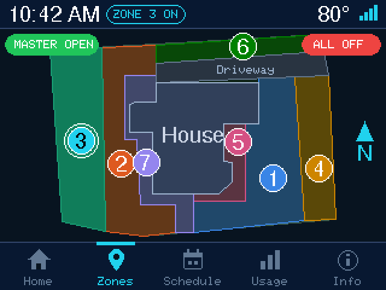 | 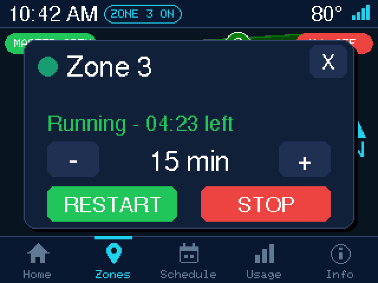 | 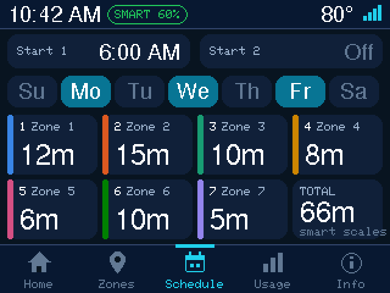 |
| Yard map, zone 3 running | Manual zone control | Schedule |
| 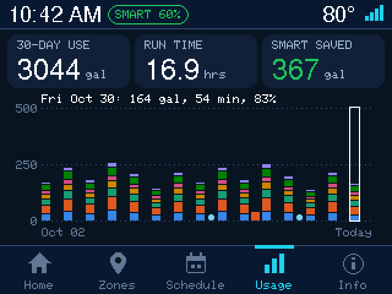 | 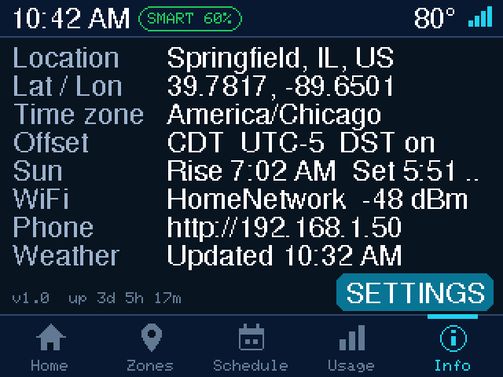 | 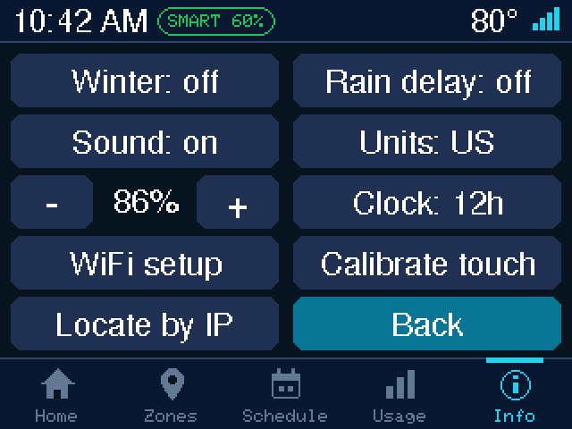 |
| 30-day usage | Location, time zone, network | Settings |
| 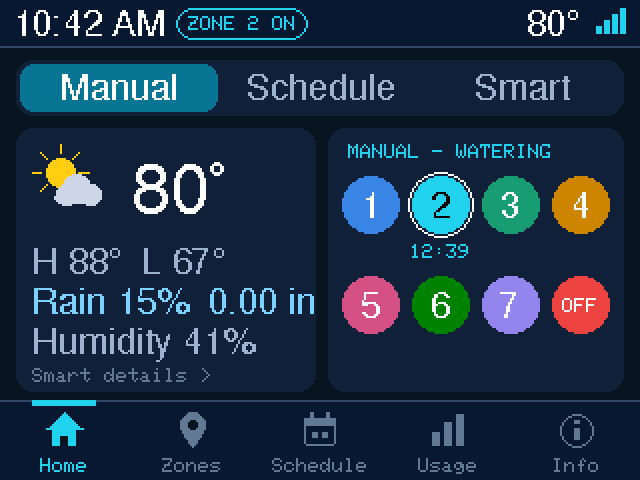 | 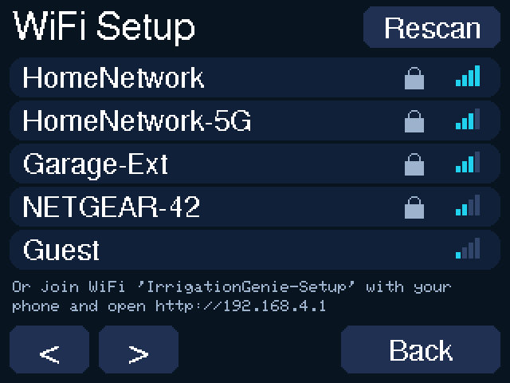 | 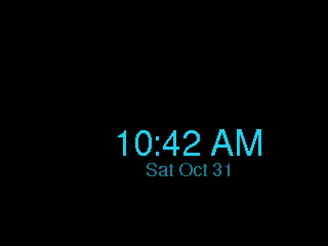 |
| Manual mode: tap any zone to run it | WiFi setup | Screen saver |

## Phone app

| | | | |
|---|---|---|---|
| 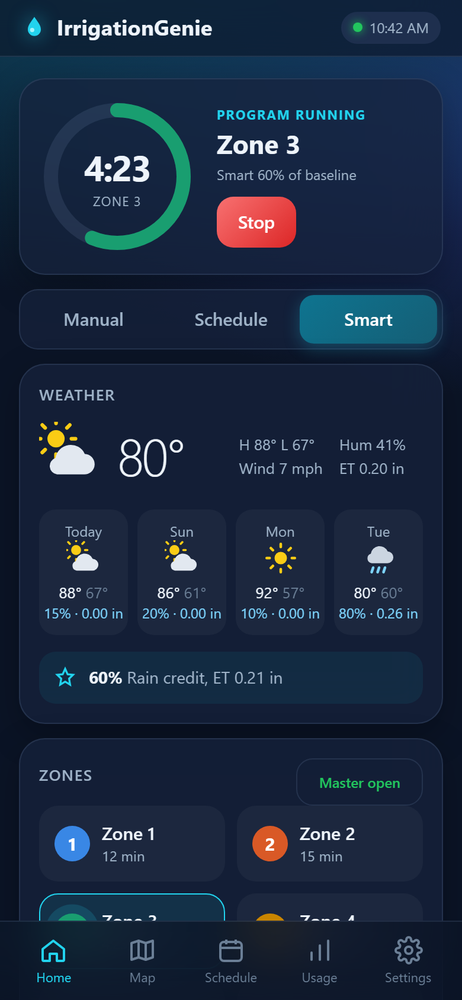 | 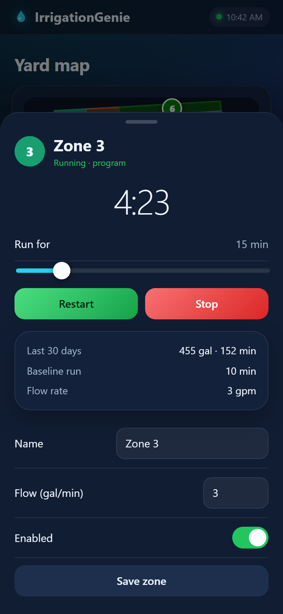 | 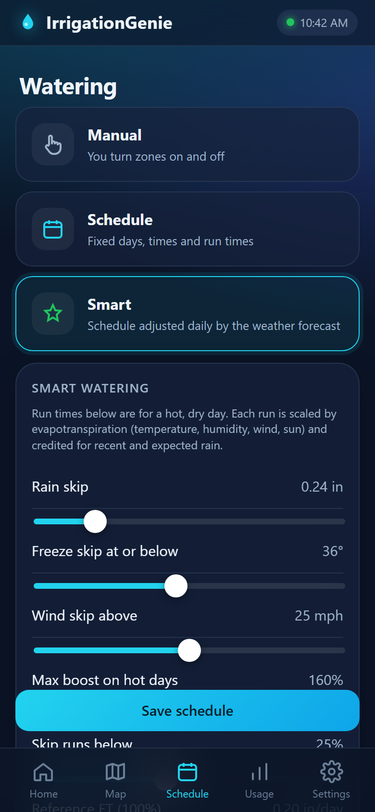 | 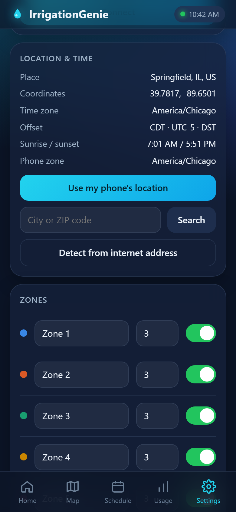 |
| Watering | Zone control | Modes and smart settings | Location and time |

## Hardware

- ESP32 dev board (ESP32-WROOM-32)
- 2.8" SPI TFT, ILI9341 with XPT2046 touch (the common red 240x320 module)
- 8 relays (master + 7 zones), each driven by a 2N2222A with a 1 kΩ base resistor and a flyback diode;
  the relays switch 24 VAC to the valves
- 24 VAC valve transformer, fused (2 A slow blow), feeding an AC/DC converter and two CA-1235 buck
  converters for 3.3 V (ESP32, TFT) and 5 V (relay coils)
- Passive piezo buzzer with a 2N2222A, and a 2N3906 for the backlight

Full parts list (with LCSC part numbers): [hardware/IrrigationGenie_BOM.csv](hardware/IrrigationGenie_BOM.csv)

## Wiring

<a href="docs/screenshots/Wiring.png">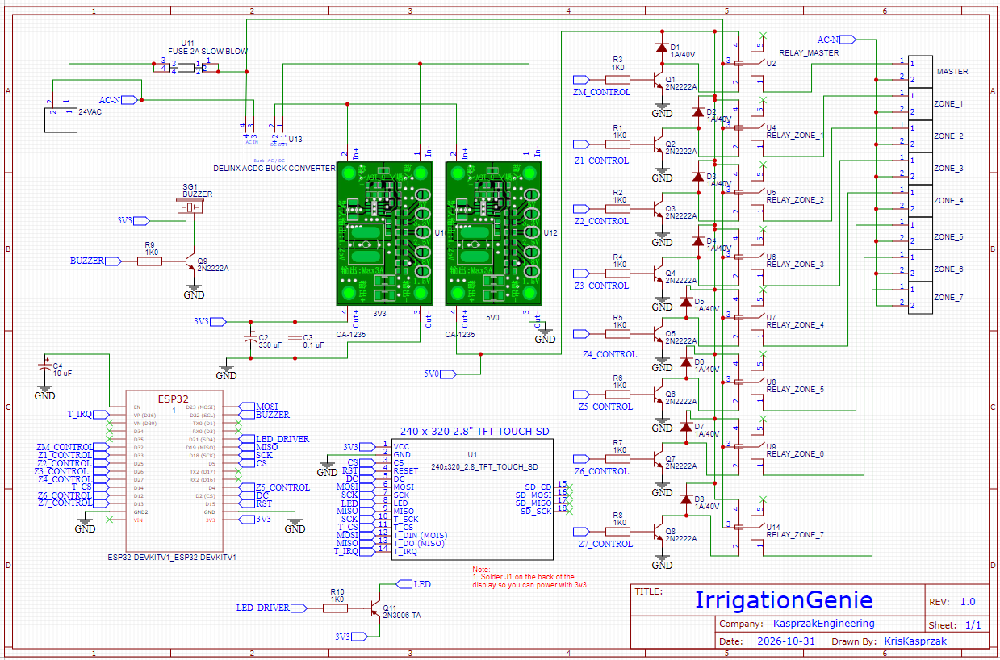</a>

The full schematic: the 24 VAC supply and the 3.3 V / 5 V converters, the ESP32, the TFT and touch connections,
the eight relay driver stages, the buzzer and the backlight switch. Click the image for full size.

### Pin summary

| ESP32 | Connects to |
|---|---|
| 18 / 23 / 19 | SCK / MOSI / MISO, shared by TFT and touch |
| 5, 2, 15 | TFT CS, DC, RESET |
| 14, 36 | touch CS, touch IRQ |
| 21 | TFT backlight PWM, through a 2N3906 PNP (1 kΩ to the base, emitter to 3.3V, collector to TFT LED) |
| 22 | piezo, through a 2N2222A (1 kΩ to the base) |
| 32 | master valve relay |
| 33, 25, 26, 27, 4, 12, 13 | zone 1..7 relays |

The output pins were chosen so the relays don't click during boot. Settings in
[`Config.h`](IrrigationGenie/Config.h):

- `RELAY_ACTIVE_LOW`: `false` for the transistor relay drivers in the schematic (HIGH = relay on);
  `true` for relay modules with active-low inputs
- `BL_ACTIVE_LOW`: backlight polarity; set it to match how your transistor is wired
- `CLICK_HZ` / `CLICK_MS`: pitch and length of the key click

Never connect valves to the ESP32 directly. If touch is unreliable, disconnect the TFT's SDO (MISO) pin;
the display doesn't need it. GPIO 12 (zone 6) is a boot strapping pin: it must not be pulled HIGH at
power-up, so don't add a pull-up to it (the transistor driver keeps it low). GPIO 16/17 are left free,
which also keeps the design compatible with WROVER modules (PSRAM).

### Power notes

- **TFT at 3.3 V:** the red ILI9341 module has its own 3.3 V regulator on VCC. Solder the **J1** jumper on
  the back of the display to bypass it, otherwise the display and touch run at about 2.9 V.
- **ESP32 supply:** the ESP32 is powered through its 3V3 pin from the 3.3 V converter (VIN is unused).
  Avoid plugging in USB while the 24 VAC supply is on, since the board's own regulator then drives the same
  3.3 V rail. To flash, either unplug the 24 VAC or power VIN from the 5 V rail instead of 3V3.
- **Converter polarity:** check the + / − markings on the AC/DC converter's DC output and wire + to In+ of
  both CA-1235 converters. Their In− and Out− are common, so a reversed input also reverses GND.
- **Fuse:** size it for your transformer; a typical 40 VA, 24 VAC transformer supplies about 1.7 A.
  A slow blow fuse rides through the valve solenoids' inrush current.
- The relay coils run from 5 V; the valves only ever see 24 VAC through the relays' normally open contacts.

## Building

Arduino IDE 2 with the **esp32 core 3.x**, board **ESP32 Dev Module**.

> **Partition scheme: Tools > Partition Scheme > Huge APP (3MB No OTA/1MB SPIFFS).**
> The sketch is about 1.35 MB; with the default scheme the build fails with
> "Sketch too big / text section exceeds available space in board".

Libraries (Library Manager): Adafruit GFX, Adafruit ILI9341, XPT2046_Touchscreen (Paul Stoffregen),
ArduinoJson 7. WiFi, WebServer, HTTPClient, LittleFS and mDNS come with the core.

Open `IrrigationGenie/IrrigationGenie.ino` and upload.

## First start

1. **Touch calibration** runs automatically: tap the three targets, test, then DONE.
   To redo it later, hold the screen during the splash or use Settings > Calibrate touch.
2. **WiFi:** pick your network on the screen and type the password. Or join the
   `IrrigationGenie-Setup` network from your phone and open http://192.168.4.1.
3. **Location:** on the phone open http://irrigationgenie.local (or the IP on the Info screen),
   go to Settings > Location & time and search your city or ZIP. *Use my phone's location* needs
   GPS, which browsers only allow on https pages, so on most phones the search is what works.
   Until then the controller uses an approximate location from your internet address.
4. Set your zones' names and flow rates (Settings), run times and days (Schedule), and pick a mode.

## How Smart mode works

The minutes you set per zone are what the yard needs on a **hot, dry reference day**
(evapotranspiration of 5 mm/day, adjustable). Before each scheduled run the controller:

1. Takes the FAO-56 reference evapotranspiration (ET₀) from Open-Meteo. That one number captures
   temperature, humidity, wind and sunshine. It blends yesterday and today and scales the run
   by ET₀ ÷ reference.
2. Subtracts **rain credit**: effective rain of the last two days, plus expected rain today
   (amount × probability), plus half of tomorrow's.
3. Adds small boosts for heat waves (≥ 35 °C) and very dry air.
4. **Skips** the run for freeze risk, heavy recent or expected rain, strong wind, or when the result
   falls below the minimum (default 25%). The result is capped at the max boost (default 160%).

The screen and the app always show the percentage and the reason, for example *"Rain credit, ET 0.21 in"*.
All thresholds are adjustable in the phone app's Schedule tab. Without weather data, Smart mode
runs the schedule at 100%.

## Repository layout

| Path | Contents |
|---|---|
| `IrrigationGenie/IrrigationGenie.ino` | setup / loop, pinout and board settings in the header |
| `IrrigationGenie/Config.h` | pins, polarity and sound settings, colors, data structures |
| `IrrigationGenie/Valves.ino` | outputs, programs, schedule, winter mode, smart watering |
| `IrrigationGenie/Net.ino` | WiFi, setup AP, NTP + time zone, weather, web API |
| `IrrigationGenie/UI.ino` | touch screen screens, touch handling, keyboard, screen saver |
| `IrrigationGenie/Gfx.ino` | drawing helpers, icons, splash, touch calibration |
| `IrrigationGenie/Storage.ino` | settings (JSON) and 30-day usage log in LittleFS |
| `IrrigationGenie/Sound.ino` | piezo sounds and backlight PWM |
| `IrrigationGenie/WebPage.h` | the phone app (HTML/CSS/JS, served from flash) |
| `IrrigationGenie/Plan.h` | default yard plan (generated) |
| `tools/plan.js` | yard plan tracing; regenerates `Plan.h` and `AerialHouseView_clean.svg` |
| `tools/screens/` | screenshot generators for the touch screen and phone app |
| `hardware/IrrigationGenie_BOM.csv` | parts list (BOM) |
| `docs/screenshots/` | the images in this README |

## Your own yard plan

`tools/plan.js` holds the zone outlines traced from `AerialHouseView.png` (a top-down sketch of the yard),
rotated so north is up. Edit the traces and run `node tools/plan.js` to regenerate
`IrrigationGenie/Plan.h`, the SVG and a preview. `Plan.h` only provides defaults for a fresh controller;
once it has saved settings, edit the zones in the phone's map editor instead. The editor can also replace
the plan with a satellite view or a photo; those are stored in LittleFS.

## Regenerating the screenshots

Both generators run the real code, so the images stay in sync with the firmware:

```sh
cd tools/screens
npm install
npm run tft      # compiles the firmware UI to WebAssembly (no compiler install) and renders each screen
npx @puppeteer/browsers install chrome-headless-shell@stable   # once, prints the executable path
CHROME_PATH=<path printed above> npm run phone                 # phone app against a mock controller
```

The TFT generator expects the Adafruit GFX library at `C:/Arduino_Sketches/libraries/Adafruit_GFX_Library`;
set `GFX_DIR` to point elsewhere.

## Phone app API

The ESP32 serves a small JSON API that the app uses, which is handy for home automation:

| Endpoint | |
|---|---|
| `GET /api/state` | live status: zones, timers, mode, smart %, next run, network |
| `GET/POST /api/config` | settings (POST accepts partial updates) |
| `GET /api/weather` | forecast and the smart decision |
| `GET /api/usage` | 30 days of per-zone run seconds |
| `POST /api/cmd` | `{"cmd":"zone","zone":3,"on":true,"min":10}`, `stopall`, `mode`, `winter`, `master`, `runnow`, `raindelay`, `refresh` |
| `POST /api/location` | `{lat, lon, place, tz, posix}` |

## License

[PolyForm Noncommercial 1.0.0](LICENSE). Copyright (c) 2026 Kris Kasprzak.

Free for personal, hobby, educational and other noncommercial use. Commercial use (selling it,
building it into a product, or using it in a business) is not permitted without a separate license
from the author.

This project is provided **as is, without any warranty**. It switches mains-powered equipment and
water valves; you build and use it at your own risk, and the author is not liable for any damage,
flooding, water bills or other loss.
